# Камадо

Личный ассистент студента. Все ДЗ, контрольные и сроки в одном месте, план недели и подготовка к сессии, фокус-таймер с дыханием на перерыве, напоминания со звуком — и музыкальный плеер с огромной пластинкой, текстами песен и заставкой-визуализатором. Писать ему можно и с телефона, через Telegram: текстом, фото или голосом.

## Скачать

### [⬇️ Скачать для Windows](https://github.com/killer-destroyer/camado/releases/latest/download/Camado-Setup.exe)

[Скачать для Mac](https://github.com/killer-destroyer/camado/releases/latest/download/Camado-mac.dmg)

Запусти скачанный файл, и Камадо установится сам: появится ярлык на рабочем столе. Больше ничего делать не нужно.

Если Windows покажет «Windows защитила ваш компьютер», нажми «Подробнее» → «Выполнить в любом случае». Так бывает с любой новой программой без платной подписи.

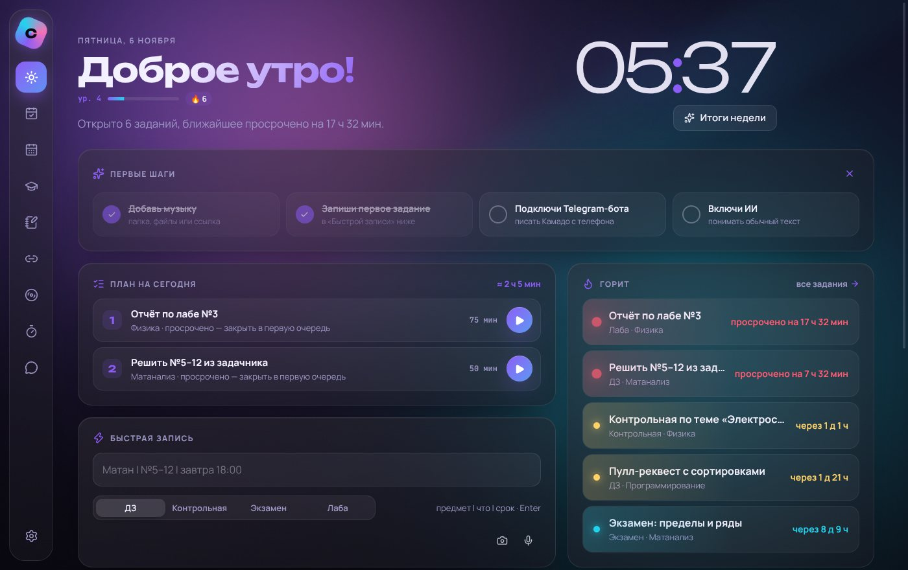

## Учёба

| | |
|---|---|
| 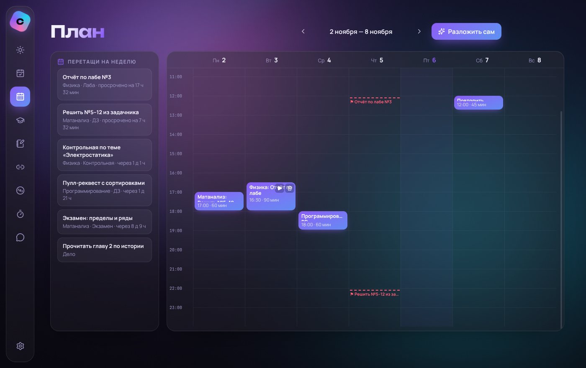 | 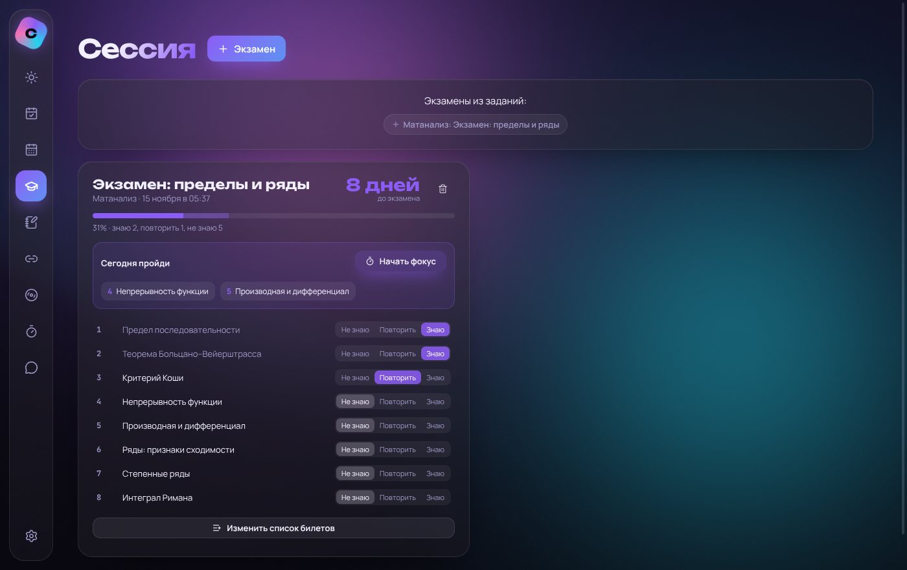 |
| 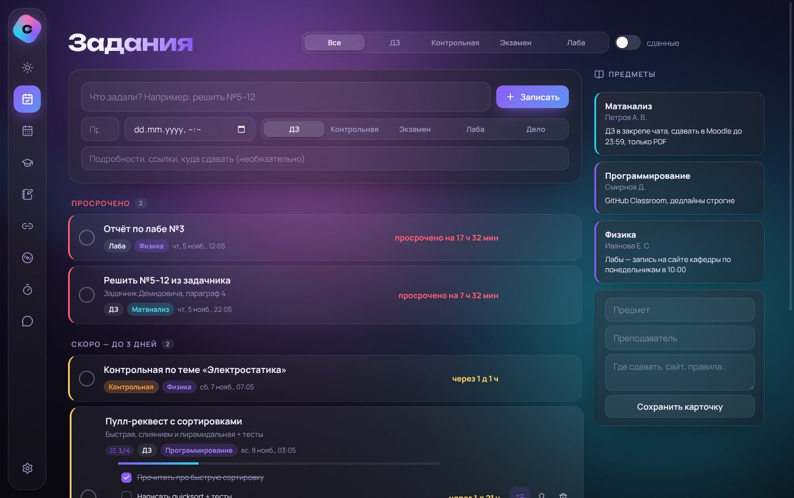 | 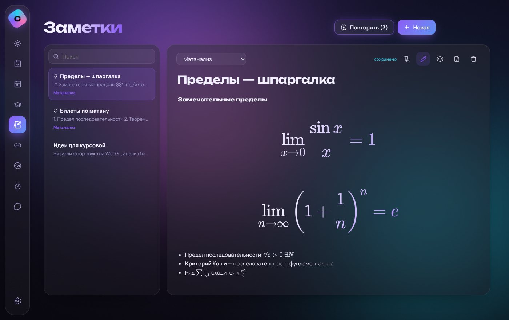 |
| 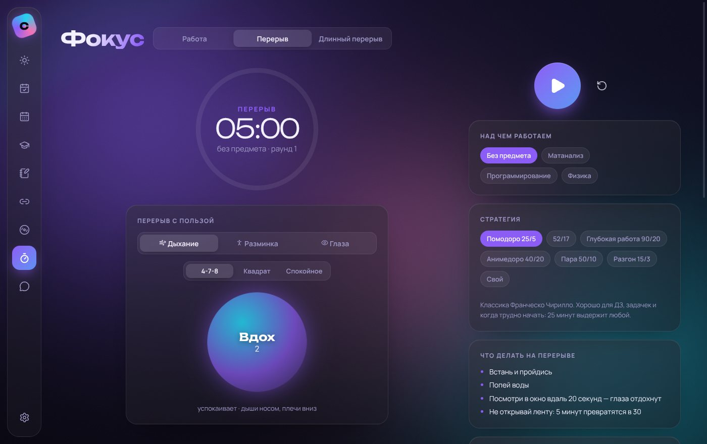 | 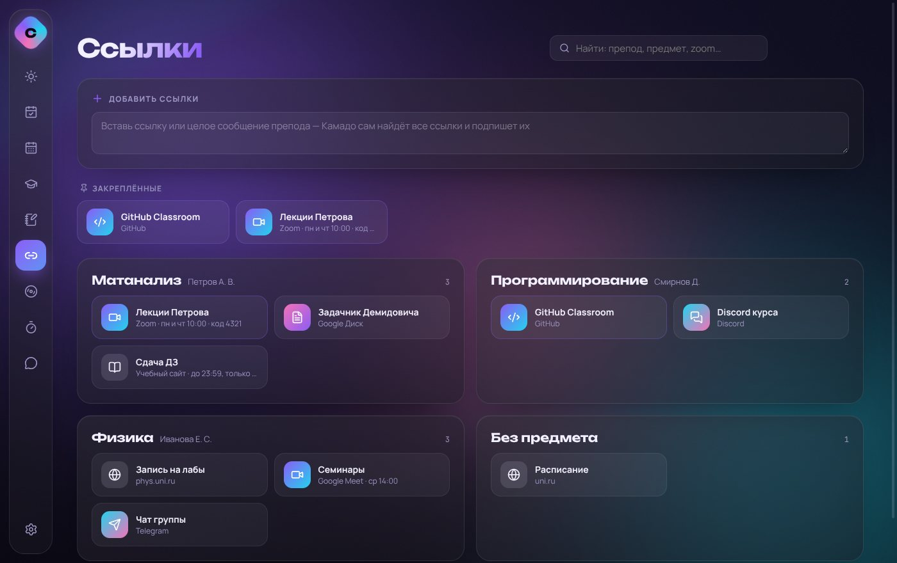 |

- **Сегодня** — план на день по срочности (▶ запускает фокус), что горит, быстрая запись текстом, **фото** или **голосом**, свои напоминания, уровень и серия дней.
- **Задания** — ДЗ, контрольные, экзамены, лабы по срочности; карточки предметов. У каждого задания:
  - **«Разбей на шаги»** — Камадо превращает курсовую в 5–7 маленьких шагов с галочками;
  - **«Помоги понять»** — репетитор объясняет тему и задаёт наводящие вопросы, но не решает за тебя.
- **План** — неделя по часам: перетаскивай задания на дни, тяни блоки за край, **«Разложить сам»** — Камадо расставит всё по свободным вечерам до сроков.
- **Сессия** — отсчёт до каждого экзамена, билеты «знаю / повторить / не знаю» и сколько учить сегодня, чтобы успеть всё.
- **Заметки** — конспекты с **формулами** (`$\lim_{x\to0}\frac{\sin x}{x}$` рисуется как в учебнике), сохранение в **PDF**, **карточки** из конспекта и повторение по интервалам, как в Anki.
- **Ссылки** — все ссылки преподов в одном месте: вставь хоть целое сообщение из чата — Камадо вытащит ссылки, подпишет и разложит по предметам.
- **Фокус** — пресеты по методикам (Помодоро, 52/17, 90/20, Анимедоро…), на перерыве — **дыхание, разминка и гимнастика для глаз**, фоновые звуки и свои плейлисты на работу и отдых.
- **Напоминания со звуком** — 10 звуков (от маримбы до фонка) или свой, громкость нарастает плавно.
- **Итоги недели и ачивки** — сколько был в фокусе, что сдал, лучший день, музыка недели, значки за серии.
- **Быстрая запись из любой программы** — Cmd/Ctrl+Shift+Пробел.
- **В меню-баре Mac** — таймер фокуса или ближайший дедлайн рядом с часами.

## Музыка

| | |
|---|---|
| 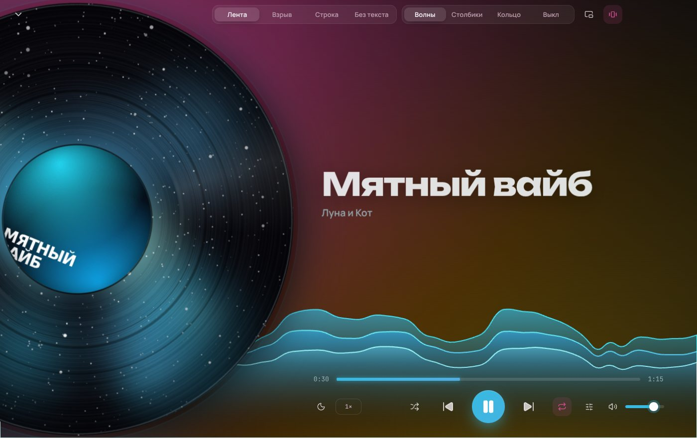 | 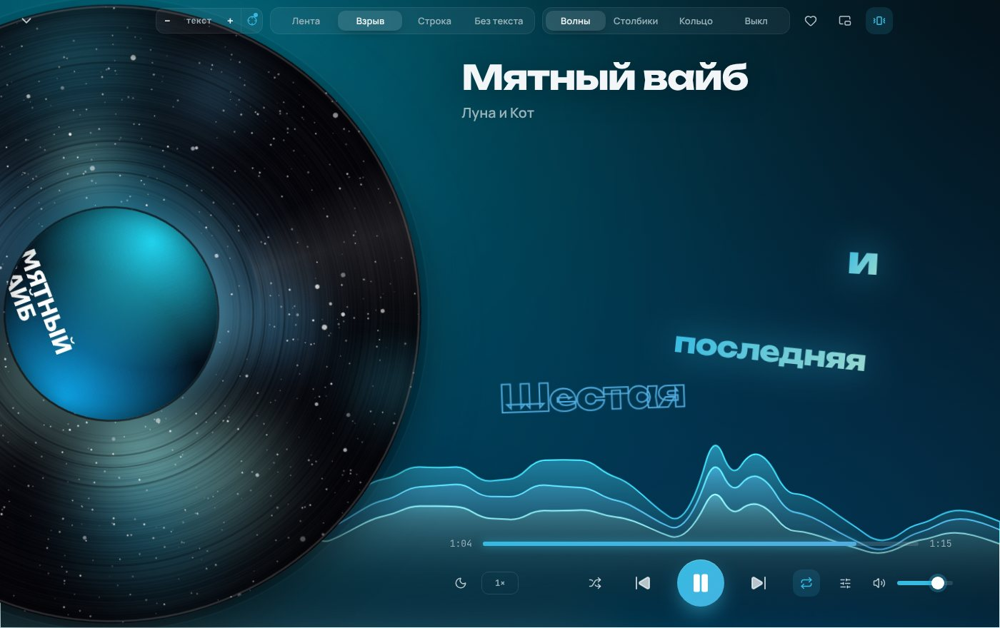 |
| 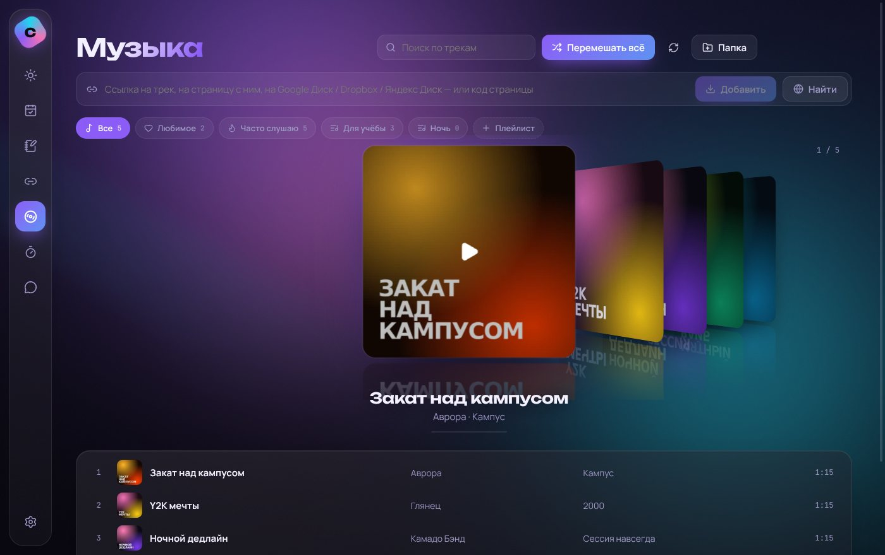 |  |

- **Огромная пластинка** с обложкой в центре — 22 вида (брызги, мрамор, мозаика, зигзаги, неон, галактика, пластинка-картинка…) в настоящих цветах обложки; кнопка «другой вид». Крути её — это скретч самой песней.
- **Тексты песен** — «Лента», «Взрыв», «Строка» и текст поверх всех окон. Разъехался текст — Камадо **сам подгонит его по звуку**: ИИ послушает песню и расставит строки (или кнопка с волной). Можно и вручную — ⌖: поймай строку, и ещё одну там, где снова разъехалось.
- **Заставка-визуализатор** — ничего не трогаешь пару минут, и экран превращается в живую сцену в цветах песни: дождь по стеклу, чёрная дыра как в «Интерстелларе», полёт сквозь звёзды, северное сияние, синтвейв, костёр, медузы… — 12 сцен, а можно поставить **свою картинку**.
- **Звук** — эквалайзер с пресетами, автовыравнивание громкости и громкость каждой песни отдельно, slowed + reverb и nightcore с ползунком скорости, плавные переходы, таймер сна.
- **Фоновые звуки** — дождь, гроза, кафе, камин, лес, море, поезд, шумы, котик — смешиваются ползунками, с музыкой и без.
- **Библиотека** — плейлисты, «Любимое», «Часто слушаю»; музыка из папки, перетаскиванием, по ссылке (файл, страница, Google Диск, Dropbox, Яндекс Диск) и **поиск бесплатной музыки** прямо в программе.
- Мини-плеер в меню-баре Mac, медиаклавиши, статус в Discord, 12 палитр и «цвета из обложки».

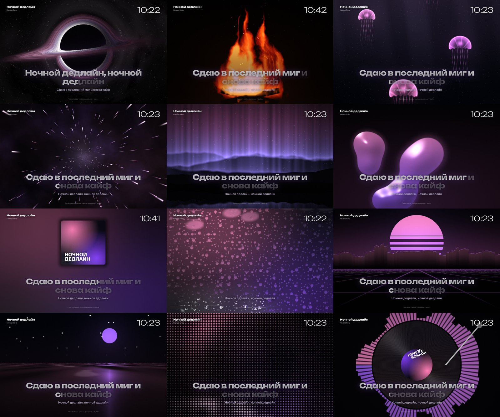

## ИИ — бесплатно

Камадо понимает обычный текст, фото и голос — и управляет программой сам: «включи Пошлую Молли», «сделай потише», «открой план», «разверни на весь экран», «поставь фокус» (и из Telegram тоже). По умолчанию — **бесплатный Google Gemini**: ключ берётся за минуту на aistudio.google.com, карта не нужна. В Настройках → ИИ можно подключить Claude или любую другую модель (OpenRouter, DeepSeek, своя на компьютере через Ollama). Лимит трат всегда включён. Без ключа всё работает вручную.

## Первые шаги

1. **Музыка** → «Папка» — выбери папку с песнями, перетащи файлы в окно или вставь ссылку на трек.
2. **Настройки → ИИ** — вставь бесплатный ключ Gemini, чтобы Камадо понимал обычный текст, фото и голос.
3. **Настройки → Telegram-бот** — чтобы писать Камадо с телефона. Там три шага с подсказками.

## Безопасность

Ключи хранятся зашифрованными (Связка ключей на Mac), бот отвечает только тебе, текст из чатов и сайтов — это данные, а не команды. Подробнее — [docs/SECURITY.md](docs/SECURITY.md).

---

Для разработчиков: [docs/DEVELOPMENT.md](docs/DEVELOPMENT.md) · план — [docs/ROADMAP.md](docs/ROADMAP.md) · известные проблемы — [docs/BUGS.md](docs/BUGS.md)
