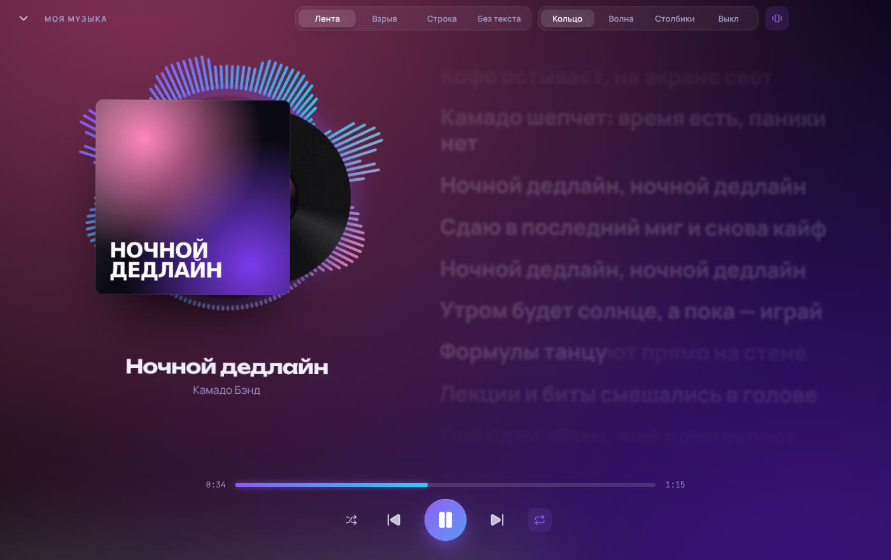
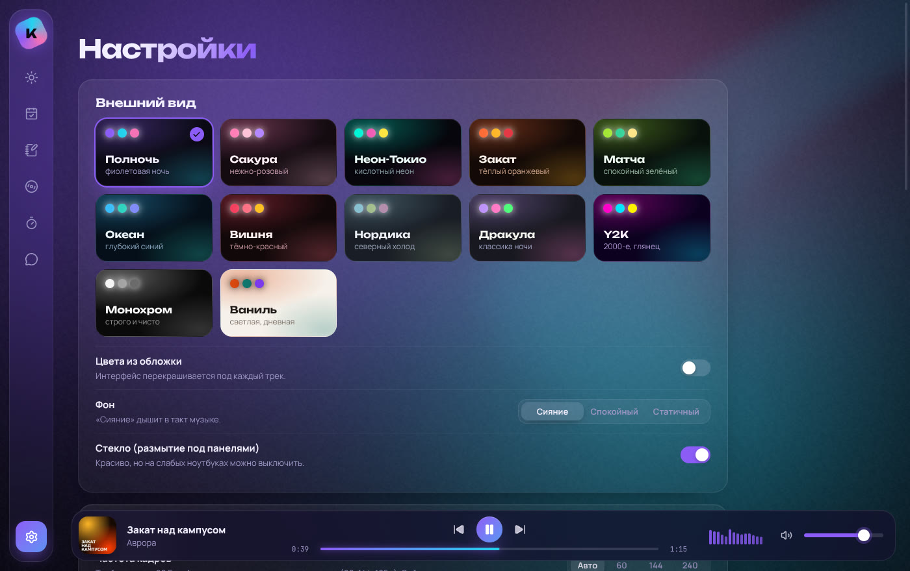

# Камадо (Camado)

Личный ассистент студента. Собирает в одном месте всё, что разбросано по сайтам и чатам преподов: ДЗ, контрольные, сроки, ссылки, правила сдачи. Напоминает о дедлайнах, держит фокус и включает музыку с текстами и визуализатором.

Работает двумя способами, и оба используют одну базу:
- **приложение для компьютера** (Windows, macOS, Linux): задания, заметки, фокус-таймер, музыкальный плеер, чат с Камадо;
- **Telegram-бот**: записывает задания с телефона и присылает напоминания. Может работать внутри приложения или отдельно на сервере.

Мозг — Claude (Anthropic API). Без ключа всё работает в ручном режиме.


## Приложение для компьютера

| | |
|---|---|
|  |  |
|  |  |
|  |  |

### Что внутри

- **Сегодня.** Большие часы, что горит (с живым обратным отсчётом), быстрая запись, неделя с точками сроков, фокус за день, что играет.
- **Задания.** Группы «просрочено / горит / скоро / позже». Отметка «сдано» с салютом. Карточки предметов: препод, где сдавать, правила.
- **Заметки.** Конспекты и билеты по предметам, автосохранение, закрепление.
- **Фокус.** Помодоро-таймер с кольцом. Привязка к предмету, статистика за неделю, на старте сам включает музыку, на перерыве делает её тише.
- **Камадо.** Чат с тем же мозгом, что и в Telegram (нужен ключ).
- **Музыка:**
  - **Моя музыка.** Папки с mp3/flac/m4a/ogg/wav, обложки из тегов. Выбор трека в 3D-карусели обложек: колесо, перетаскивание с инерцией, стрелки.
  - **«Сейчас играет»** на весь экран. Пластинка выезжает из конверта и крутится 33⅓ об/мин; её можно крутить мышкой, это перемотка.
  - **Визуализатор:** «Кольцо» вокруг пластинки, «Волна», «Столбики».
  - **Текст песни** в трёх режимах:
    - «Лента» — плавная прокрутка с караоке-заливкой по словам;
    - «Взрыв» — слова выпрыгивают в случайных местах окна, разными размерами и стилями;
    - «Строка» — одна крупная строка.
  - **Тряска в такт:** детектор ударов баса. Настраиваются сила, чувствительность, поворот, пульс и что трясти: сцену, обложку или текст.
  - **Яндекс Музыка и SoundCloud.** Их официальные сайты прямо в приложении: входишь в свой аккаунт и слушаешь как обычно. Камадо видит, что играет, показывает текст и плеер на весь экран. Визуализатор слушает системный звук (Windows и macOS).
- **12 палитр** (Полночь, Сакура, Неон-Токио, Закат, Матча, Океан, Вишня, Нордика, Дракула, Y2K, Монохром, светлая Ваниль). Режим **«цвета из обложки»** перекрашивает интерфейс под каждый трек. Цвета при смене перетекают плавно.
- **Живой фон** (WebGL-«сияние»), дышит в такт музыке.
- **Плавность на любом мониторе.** Анимации идут по частоте экрана (60, 144, 165 Гц…) и не зависят от неё. Можно ограничить FPS и включить счётчик.
- **Ctrl+K** — командная строка: перейти, включить, сменить палитру или режим текста.
- **Уведомления о сроках** на рабочий стол. Работает из трея, когда окно закрыто.

### Тексты песен: откуда берутся

1. Файл `.lrc` рядом с песней с тем же именем (`Песня.mp3` → `Песня.lrc`). Пословные метки (`<00:12.30>`) тоже поддерживаются.
2. Текст, встроенный в теги файла.
3. Бесплатная открытая база [LRCLIB](https://lrclib.net). Найденное кэшируется, повторно сеть не нужна.

### Как запустить приложение

Нужен **Node.js 22.13 или новее** ([nodejs.org](https://nodejs.org)).

```bash
npm install
```

```bash
npm run app
```

Откроется окно Камадо. Дальше:
1. В «Музыке» нажми «Папка» и выбери папку с музыкой, или просто перетащи файлы в окно.
2. Чтобы включить ИИ, открой Настройки → ИИ и вставь ключ (см. ниже, где его взять).
3. Чтобы бот работал вместе с приложением, создай `.env` по образцу `.env.example` и впиши `TELEGRAM_BOT_TOKEN` (как получить — в разделе про бота).

Собрать без режима разработки и запустить:

```bash
npm run app:build
```

```bash
npm run app:start
```

**Горячие клавиши:** пробел — пауза, Shift+→ / Shift+← — следующий / предыдущий трек, ← / → в плеере — перемотка на 5 с, Esc — свернуть плеер, Alt+1…7 — экраны, Ctrl+K — команды. Медиа-клавиши клавиатуры тоже работают.

> Не запускай одновременно приложение с ботом и `npm run dev`: Telegram не даёт одному боту работать в двух местах. В настройках приложения бота можно выключить.

## Telegram-бот

### Два режима

**Ручной: бесплатно, ключ не нужен.** Задания вписываешь командами, Камадо хранит их и напоминает.

| Команда | Что делает |
|---|---|
| `/add Матан \| №5–12 \| 07.11` | записать ДЗ (предмет, что сделать, срок) |
| `/kr`, `/exam`, `/lab` | то же для контрольной, экзамена, лабы |
| `/done 3`, `/del 3` | сдал задание #3 / убрать его |
| `/dz` | открытые задания |
| `/subject Физика \| Иванов И.И. \| сдавать в Moodle` | карточка предмета |
| `/subjects` | все карточки |
| `/settings` | режим, модели, траты, пояс |

Срок пишется так: `07.11`, `07.11 18:00`, `сегодня`, `завтра 10:00`. Без времени ставится 23:59. Предмет и срок можно не указывать. В приложении то же самое работает в «Быстрой записи».

**Полный: с ключом Anthropic API.** Отправь боту `/key sk-ant-...`. Он сразу удалит сообщение с ключом из чата, проверит ключ и включит ИИ. После этого Камадо:
- понимает обычный текст: «по матану №5–12 к пятнице», «сдал лабу», «что у меня на завтра?»;
- разбирает пересланные сообщения преподов: задания, сроки, ссылки;
- сам ведёт карточки предметов и запоминает важное о тебе.

Выключить ИИ: `/key off`.

**В обоих режимах:** напоминания за 3 дня до контрольных и экзаменов, за сутки и за 3 часа до любого срока. Утренняя сводка в 8:00. Бот отвечает только тебе.

### Как запустить бота отдельно (например, на сервере)

**1. Создай бота.** Напиши [@BotFather](https://t.me/BotFather) команду `/newbot`, придумай имя и юзернейм. BotFather пришлёт токен вида `123456:ABC...`.

**2. (Можно позже) Получи ключ Anthropic API.** Зайди на [console.anthropic.com](https://console.anthropic.com), пополни баланс, затем API Keys → Create Key. Ключ можно вписать в `.env`, прислать боту командой `/key` или вставить в настройках приложения. В консоли можно поставить лимит трат на уровне аккаунта.

**3. Настрой.**

```bash
npm install
```

```bash
cp .env.example .env
```

Открой `.env`, впиши `TELEGRAM_BOT_TOKEN` и проверь `CAMADO_TIMEZONE`.

**4. Узнай свой Telegram ID.**

```bash
npm run dev
```

Напиши боту `/id`, впиши число в `OWNER_TELEGRAM_ID` в `.env`. `npm run dev` сам перезапустится.

Для постоянной работы на сервере:

```bash
npm run build
```

```bash
npm start
```

## Сколько стоит

Модели задаются в `.env`:

| Уровень | Модель по умолчанию | Цена за 1 млн токенов (вход / выход) | Для чего |
|---|---|---|---|
| fast | Claude Haiku 5.5 | $0.10 / $0.50 | массовый разбор чатов (следующие версии) |
| brain | Claude Sonnet 5.5 | $2 / $10 | разговор, ДЗ, инструменты |
| smart | Claude Opus 5.5 | $4 / $20 | сложные планы, разбор тем (следующие версии) |

Системный промпт кэшируется, поэтому повторные запросы стоят дешевле. Лимит в месяц задаёт `CAMADO_MONTHLY_BUDGET_USD` (по умолчанию $25). Траты видно командой `/spend` и в настройках приложения. Музыка, тексты, напоминания и фокус работают без модели — бесплатно.

## Как устроен

```
src/                ядро (общее для бота и приложения)
  core.ts           сборка Камадо из частей
  index.ts          серверный режим: бот + напоминания
  bot.ts            Telegram-бот (grammY)
  manual.ts         разбор «предмет | что | срок» и дат
  reminders.ts      напоминания и утренняя сводка
  store.ts, db.ts   база SQLite: задания, предметы, заметки, фокус, память, траты
  camado/           характер, мозг и инструменты ИИ
  llm/              интерфейс модели, адаптер Claude, учёт денег
desktop/            приложение для компьютера (Electron)
  main/             фон: окно, трей, уведомления, библиотека музыки, тексты, бот
  preload/          мост между окном и фоном
  shared/           общие типы, настройки, разбор LRC
  renderer/         интерфейс (React)
    lib/            звук и визуализация, палитры, цикл кадров
    state/          состояние: плеер, данные, фокус
    components/     фон, карусель, пластинка, тексты, визуализатор, онлайн-плееры
    screens/        Сегодня, Задания, Заметки, Музыка, Фокус, Камадо, Настройки
test/               тесты (npm test)
```

Чтобы подключить другую модель (например GLM), напиши ещё один класс с интерфейсом `LLMProvider` рядом с `src/llm/anthropic.ts`.

## Разработка

```bash
npm test
```

```bash
npm run typecheck
```

План развития — в [docs/ROADMAP.md](docs/ROADMAP.md).
